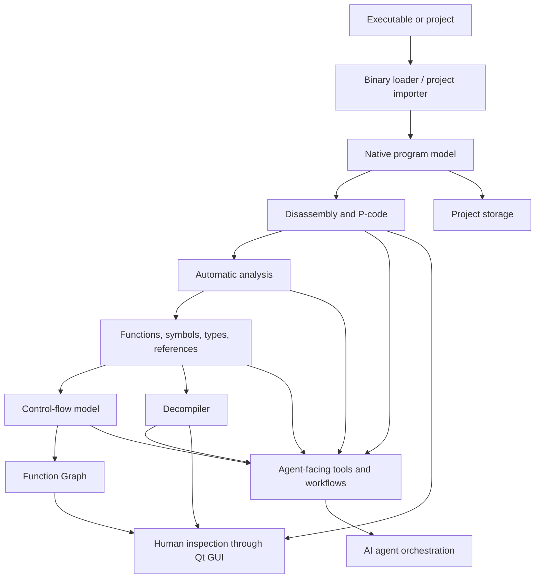

<div align="center">

# Enigma

### Native Reverse Engineering Engine for AI Agents

**Give AI agents access to real binary-analysis capabilities — not just reverse-engineering prompts.**

[](LICENSE)
[](https://isocpp.org/)
[](https://www.qt.io/)
[](https://github.com/BunnyBuzz/Enigma/stargazers)

</div>

---

## What is Enigma?

Enigma is a native C++ reverse-engineering engine inspired by Ghidra's analysis pipeline. It provides the core capabilities needed to inspect, disassemble, analyze, and decompile executable binaries, with an architecture intended to make those capabilities usable by AI agents as well as by human analysts.

Traditional reverse-engineering workflows often make the analyst navigate a GUI, inspect individual instructions, follow references, and manually connect findings. Enigma's direction is different: expose the underlying analysis capabilities so an agent can perform focused investigations, follow evidence across a program, and report what it finds — while a human can inspect and direct the work.

Enigma is an analysis engine, not an LLM and not merely a prompt collection. Its analysis is performed by native tooling; an AI agent provides the reasoning and orchestration around those capabilities.

## Core capabilities

### Binary loading

Enigma's loading pipeline supports multiple executable and object-file formats:

- PE
- ELF 32-bit and 64-bit
- Mach-O 32-bit and 64-bit, including fat/universal binaries
- dyld shared-cache support
- COFF objects and archives
- Intel HEX and Motorola S-Record
- Ghidra project import formats: `.gzf`, `.gbf`, and `.rep`

### Disassembly and processor support

- x86 and x86-64
- ARM and AArch64
- MIPS, including MIPS16e variants
- PowerPC
- Capstone-based instruction decoding with compiled SLEIGH processor specifications
- P-code generation through the native Ghidra decompiler library

### Program analysis

The engine maintains a program model containing memory, instructions, functions, symbols, references, data types, relocations, and related analysis state.

Analysis capabilities include:

- Function discovery and boundary analysis
- Symbol and reference analysis
- Data-type recovery
- Cross-reference inspection
- Registered automatic analyzers
- Function and basic-block analysis
- Project persistence using FlatBuffers and LMDB, with Git-like commits and branches

### Control-flow analysis

Enigma includes a Qt-independent control-flow model and a Function Graph view.

- Basic-block construction and control-flow edges
- Conditional and unconditional branch analysis
- Direct and computed control-flow edge representation
- Basic-block layout and orthogonal edge routing
- Function Graph visualization with selectable edges and navigation back to disassembly
- Synchronization between the graph and the current disassembly location

**Terminology:** a Function Graph represents control flow within a function. It is distinct from a program-wide Call Graph, which represents caller/callee relationships between functions.

### Decompilation

Enigma integrates Ghidra's native C++ decompiler library and provides a native C++ program model around it.

Available functionality includes C-like decompilation, type information, function signatures, symbols, comments, and other program metadata used during analysis.

### Desktop interface


The Qt 6 interface provides a human-inspection environment for the engine:

- Interactive disassembly
- Decompiler view
- Hex view and patching
- Function Graph
- Cross-reference exploration
- Function and symbol navigation
- Synchronized navigation between analysis views
- Function and symbol renaming

The GUI is one way to inspect and direct analysis; it is not the definition of the engine itself.

## Enigma and AI agents

Enigma is being developed around an agent-oriented workflow. The goal is to let an AI agent use reverse-engineering capabilities as concrete operations rather than imitate a human clicking through a desktop application.

An agent-assisted investigation can be organized as follows:

1. **Inspect** the target binary and identify its format, architecture, and relevant regions.
2. **Disassemble** the code and locate functions, symbols, and references.
3. **Analyze control flow** by examining basic blocks, branches, and function-level graphs.
4. **Decompile selectively** when higher-level understanding is useful.
5. **Follow relationships** across references and function calls, verifying each conclusion against available evidence.
6. **Report findings** with addresses, supporting observations, and clearly marked uncertainty.

The repository includes agent-facing instructions. The exact operations available to an agent depend on the tools and interfaces present in the installed Enigma build. Consult the repository's current agent instructions and each tool's help output; do not assume that a separate MCP server or dynamic plugin interface is available unless it is explicitly provided by the build.

## Architecture



## Original implementation and Ghidra components

Enigma uses selected Ghidra technologies where they provide the low-level processor and decompilation functionality required by the project. The surrounding program model, analysis pipeline, storage layer, loaders, and Qt interface are implemented natively in Enigma.

| Component | Origin |
|---|---|
| Native decompiler library | Ghidra C++ decompiler |
| SLEIGH processor specifications | Ghidra |
| Program model | Native Enigma C++ implementation |
| Memory, symbols, references, and data-type systems | Native Enigma C++ implementation |
| Analysis pipeline | Native Enigma C++ implementation |
| Binary loading | Native Enigma implementation |
| Project storage | Native Enigma implementation |
| Desktop interface | Native Qt 6 implementation |

## Building from source

### Requirements

- C++17-compatible compiler
- CMake 3.16 or newer
- Ninja
- MSYS2 / MinGW-w64 on Windows
- Capstone
- SQLite3
- LMDB
- FlatBuffers and `flatc`
- zlib
- nlohmann/json
- Qt 6 (Widgets, Core, and Gui) for the desktop interface
- Python 3 for Python-based regression tests

### Build

```bash
git clone https://github.com/BunnyBuzz/Enigma.git
cd Enigma/Enigma-Engine

cmake -B build -G Ninja -DCMAKE_BUILD_TYPE=Release -DENABLE_GUI=ON
cmake --build build
ctest --test-dir build --output-on-failure
```

Dependency availability and compiler configuration may vary by platform. Refer to the repository's build scripts and project documentation for the exact setup used by the current development environment.

## Project status

Enigma is under active development. The native analysis pipeline, decompiler integration, project storage, and Qt interface are implemented, and the Function Graph has been added and verified in the development workflow.

At the latest reported verification point for the Function Graph work:

- The GUI target built successfully.
- The CTest suite passed **73/73**.
- The new Function Graph layout tests passed **34/34**.
- An offscreen run of the real MainWindow completed the graph, navigation, and synchronization smoke checks.

A pre-existing heap-corruption issue during application teardown was separately identified in the `PatchMemory` ownership path. Functional checks completed before teardown; the shutdown issue should not be interpreted as a Function Graph failure. Check the current issue tracker and `PLAN/PROGRESS.md` for subsequent status.

## Documentation

- `PLAN/` — project plans, progress, and technical design notes
- Repository agent instructions — guidance for AI agents working with Enigma
- `Enigma-Engine/` — engine, GUI, tools, and tests

## License

Enigma is licensed under the Apache License 2.0. Third-party components remain subject to their respective licenses.
